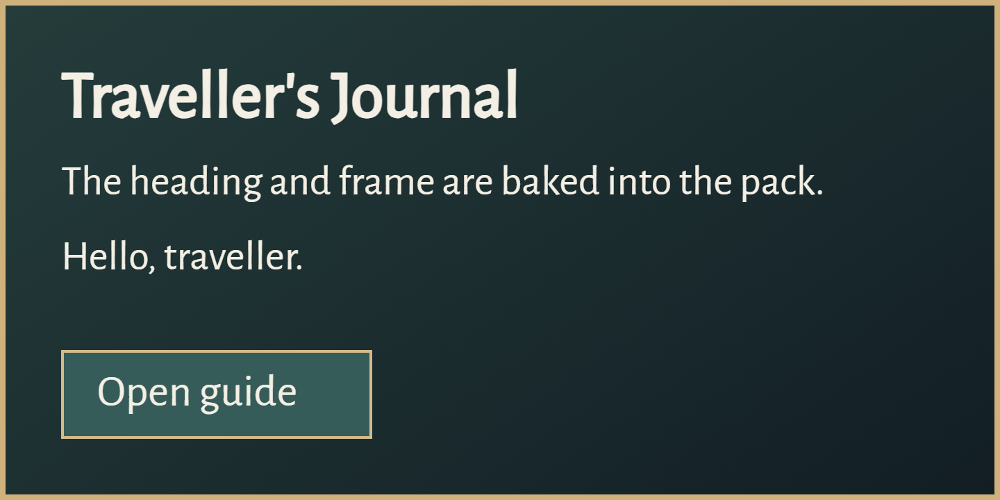

# Rhea

Create interactive Minecraft dialogs using HTML and CSS. 

## Dependency
For a Gradle Kotlin build:

```kotlin
repositories {
    maven("https://repo.erethon.de/snapshots/")
}

dependencies {
    implementation("de.erethon.rhea:Rhea:0.1.0-SNAPSHOT")
}
```
## Example



The [example plugin](examples/simple/plugin/src/main/java/de/erethon/rhea/example/RheaExamplePlugin.java) opens two pages with `/rheademo`.

### Try it

You need Java 25, Paper 26.3, and Node 20+.

```sh
cd compiler
npm ci
npx playwright install chromium
cd ..
node compiler/rhea.mjs --source examples/simple --output build/simple
./gradlew -p examples/simple/plugin build
```

The example JAR and `rhea-example-pack.zip` land in `examples/simple/plugin/build/libs/`. 
Install the JAR and serve the ZIP as a resourcepack somehow (or add it yourself locally) and then run `/rheademo` to open the UI.

In your own plugin, bundle the generated `templates/` folder and merge `pack/assets/` into your server resource pack.

Package Rhea with your plugin JAR, for example with Shadow.

## HTML markers
Rhea uses some special attributes for binding and layout.

Put these inside a `#rhea-page`:

| Attribute | Use                                              |
| --- |--------------------------------------------------|
| `data-rhea-action="switch:page"` | Clickable area, you can bind actions to this.    |
| `data-rhea-slot="greeting"` | Box for live text.                               |
| `data-rhea-align="center"` | Left, center, or right text alignment.           |
| `data-rhea-font-shift="6"` | Override the measured vertical offset if needed. |
| `data-label="heading"` | Text baked in from `rhea.json`.                  |
| `data-rhea-selected="guide"` | Add `selected` when this key is active.          |

- Use CSS to position text. Fonts used for live text need a local TTF `@font-face`. Rhea takes the font, size, and line height from the page. IDs must be unique. Targets must fit on the canvas and not overlap, except a slot inside its action.

- Set `"selected": "guide"` on a page in `rhea.json` to select matching elements. You can use an array for multiple keys. The keys are also set on `#rhea-page`, so CSS like `#rhea-page[data-rhea-selected~="guide"]` works. 

- JavaScript, form controls, scrolling, and browser hover effects don't carry over. Rhea essentially takes a screenshot of the page and overlays live text, so you can use CSS to style the page, but not to add interactivity.

- `renderScale` (1–6) controls sharpness and pack size. 

- The canvas can be up to 1000×720. Its height must be divisible by 9 (Minecraft text line height).

## Show a Rhea UI

I highly recommend looking at the example plugin for a full working example.

Inside a `JavaPlugin`, with a `Player player`:

```java
Rhea rhea = new Rhea(this);
RheaTemplate page = RheaTemplate.read(this, "rhea/main.json");

rhea.dialog(page, Component.text("Journal"), Component.text("Close"))
    .slot("greeting", Component.text("Hello, " + player.getName()))
    .action("switch:page", clicked -> clicked.sendMessage(Component.text("Guide clicked")))
    .show(player);
```

`.slot(...)` wraps and shortens overflow. 
Translate components on the server first, GlobalTranslator does not support dialogs sadly.

Adventure click and hover events work inside live text too, as you expect.

For pagination, `wrap` returns measured `SlotLine` values. Supply one page of them with the builder:

```java
List<Rhea.SlotLine> lines = rhea.text(articlePage, "article")
    .wrap(article, articlePage.slot("article").width());
int pageSize = articlePage.slot("article").height() / articlePage.slot("article").lineAdvance();

rhea.dialog(articlePage, Component.text("Journal"), Component.text("Close"))
    .lines("article", lines.subList(0, Math.min(pageSize, lines.size())))
    .show(player);
```

For a more custom layout: `new Rhea.SlotLine(component, measuredWidth)`.

Basic Javadocs are available [here](https://repo.erethon.de/javadoc/snapshots/de/erethon/rhea/Rhea/0.1.0-SNAPSHOT/raw/de/erethon/rhea/package-summary.html).
